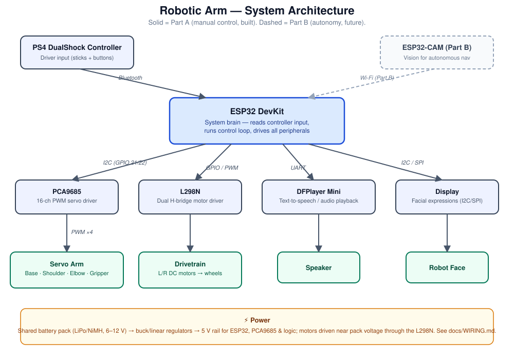
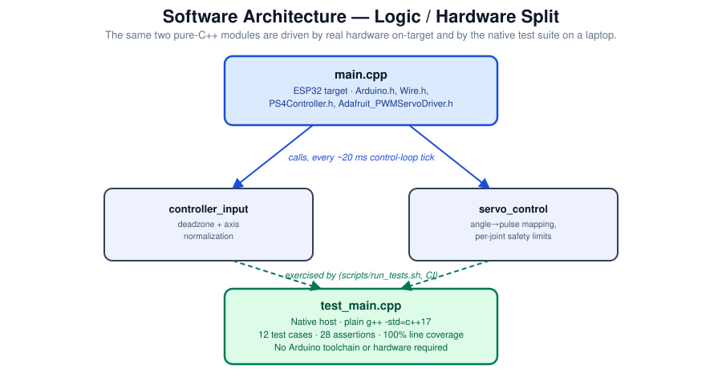
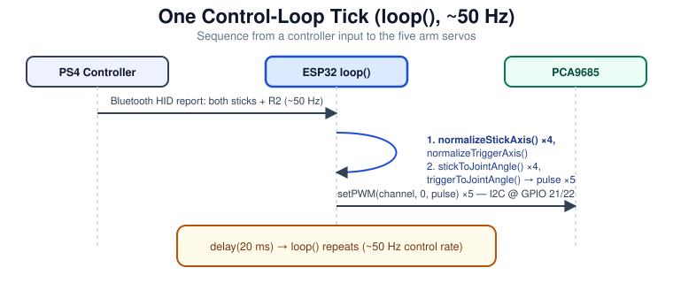
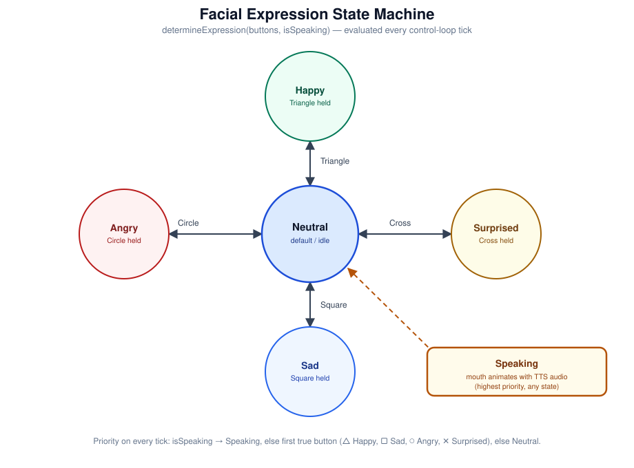

# Robotic Arm

[](https://github.com/IbanCoulibaly/robotic-arm/actions/workflows/ci.yml)
[](firmware)
[](docs/WIRING.md)
[](LICENSE)

A PS4-controller-driven robot: a 4-DOF arm, a two-wheel drivetrain, a
text-to-speech voice, and a display that shows facial expressions — all
running on a single ESP32. Built as a two-part project: **Part A** (this
repo's firmware target) is fully manual, human-in-the-loop control; **Part
B** (roadmap) adds a camera and onboard autonomy.

The firmware's control logic — deadzone filtering, drive mixing, servo angle
mapping, joint safety limits, and the facial-expression state machine — is
written as plain, hardware-independent C++ and covered by a native unit test
suite: **23 test cases, 203 assertions, 100% line coverage**, running in CI
on every push. See [Testing & Metrics](#testing--metrics).

## Table of contents

- [How it works](#how-it-works)
- [Repository structure](#repository-structure)
- [Hardware](#hardware)
- [Getting started](#getting-started)
- [Testing & metrics](#testing--metrics)
- [Roadmap](#roadmap)
- [Contributing](#contributing)
- [License](#license)

## How it works

A PS4 DualShock controller pairs to the ESP32 over Bluetooth. On every
~20 ms control-loop tick, the firmware reads the controller's stick and
button state, and turns it into four simultaneous outputs: drivetrain motor
speeds, four servo angles (base/shoulder/elbow/gripper), an optional TTS
trigger, and a facial expression on the display.

**System architecture** — which board talks to which peripheral over which bus:



**Software architecture** — the firmware is split into hardware glue
(`main.cpp`, ESP32-only) and pure control logic (everything else), so the
logic can be unit-tested on a laptop with no robot attached:



**One control-loop tick**, start to finish:



**Facial expression state machine** — priority is speaking-overrides-all,
then the held emotion button, then neutral:



Deeper design rationale (bus choices, chassis material trade-offs, why the
logic/hardware split exists) lives in [docs/ARCHITECTURE.md](docs/ARCHITECTURE.md).

## Repository structure

```
robotic-arm/
├── firmware/
│   ├── include/            # Public headers for the logic layer
│   │   ├── controller_input.h
│   │   ├── motion_control.h
│   │   ├── servo_control.h
│   │   └── expression_engine.h
│   └── src/
│       ├── controller_input.cpp   # Deadzone + stick normalization
│       ├── motion_control.cpp     # Arcade-drive mixing
│       ├── servo_control.cpp      # Angle<->pulse mapping, joint limits
│       ├── expression_engine.cpp  # Facial-expression state machine
│       └── main.cpp               # ESP32 entry point (hardware glue only)
├── test/
│   ├── minitest.h           # ~80-line dependency-free test framework
│   └── test_main.cpp        # 23 unit tests for the logic layer
├── scripts/
│   └── run_tests.sh         # Build, run, and report coverage locally / in CI
├── docs/
│   ├── ARCHITECTURE.md
│   ├── BOM.md
│   ├── WIRING.md
│   └── diagrams/             # Source SVGs for the diagrams in this README
└── .github/workflows/ci.yml  # Runs scripts/run_tests.sh on every push/PR
```

## Hardware

Full bill of materials: [docs/BOM.md](docs/BOM.md).
Pin map and bus assignments: [docs/WIRING.md](docs/WIRING.md).

Core components: ESP32 DevKit · PCA9685 servo driver · L298N motor driver ·
PS4 DualShock controller · DFPlayer Mini (TTS) · LCD/OLED face display ·
3D-printed single arm ([reference model](https://www.printables.com/model/818975-compact-robot-arm-arduino-3d-printed/files)) ·
tank-track chassis ([reference model](https://www.thingiverse.com/thing:971568/files)).

## Getting started

### Flash the firmware (on real hardware)

1. Install the [Arduino IDE](https://www.arduino.cc/en/software) with ESP32
   board support, plus the libraries used in `main.cpp`: `PS4Controller`,
   `Adafruit_PWMServoDriver`, `Wire` (bundled).
2. Open `firmware/src/main.cpp` as a sketch (or load the `firmware/` folder
   in PlatformIO using an `esp32dev` environment).
3. Wire the board per [docs/WIRING.md](docs/WIRING.md).
4. Set your PS4 controller's MAC in `PS4.begin("...")` if you want to pair
   to one specific controller.
5. Flash, power on, and pair the controller.

### Run the unit tests (no hardware required)

Everything in `firmware/include` / `firmware/src` except `main.cpp` is plain
C++17 with no Arduino dependency, so the control logic can be built and
tested on any machine with `g++`:

```bash
./scripts/run_tests.sh
```

## Testing & metrics

`scripts/run_tests.sh` compiles the logic layer plus `test/test_main.cpp`
with `g++ -std=c++17 --coverage`, runs the resulting binary, and reports
per-file line coverage via `gcov`. It's also what CI runs on every push —
see the badge at the top of this README.

**Last measured results** (reproduce locally with `./scripts/run_tests.sh`):

| Metric | Result |
|---|---|
| Test cases | 23 |
| Assertions | 203 |
| Failures | 0 |
| `controller_input.cpp` line coverage | 100% (9/9 lines) |
| `motion_control.cpp` line coverage | 100% (12/12 lines) |
| `servo_control.cpp` line coverage | 100% (16/16 lines) |
| `expression_engine.cpp` line coverage | 100% (8/8 lines) |

What's covered: joystick deadzone edge cases, arcade-drive mixing (including
that full-throttle + full-turn scales down instead of clipping and silently
losing the turn), servo angle↔pulse mapping at its endpoints and midpoint,
out-of-range input clamping for both sticks and angles, per-joint mechanical
safety limits, and every transition in the facial-expression priority order
(speaking overrides all emotion buttons).

`main.cpp` is intentionally excluded from this suite — it's ESP32-only
hardware glue (`PS4Controller`, `Wire`, `Adafruit_PWMServoDriver`) with no
branching logic of its own to test; its correctness is validated on real
hardware instead.

## Roadmap

- [x] **Part A** — manual control: drivetrain, 4-DOF arm, facial
      expressions, TTS hook, fully unit-tested control logic.
- [ ] **Part A** — hardware bring-up: wire the physical PCA9685 / L298N /
      DFPlayer Mini / display, tune joint limits to the real arm.
- [ ] **Part B** — ESP32-CAM-based obstacle/vision awareness.
- [ ] **Part B** — autonomous navigation.
- [ ] **Part B** — AI-driven speech interaction.

Full details: [docs/ARCHITECTURE.md#roadmap](docs/ARCHITECTURE.md#roadmap).

## Contributing

Issues and PRs welcome. If you're changing control logic in
`firmware/include`/`firmware/src`, add or update a test in
`test/test_main.cpp` and run `./scripts/run_tests.sh` before opening a PR —
CI will run the same script.

## License

[MIT](LICENSE)
